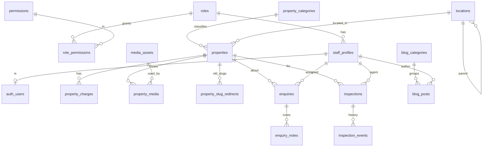

# Msendo Noble Homes: architecture

## 1. Plan in one page

| Area | Decision |
| --- | --- |
| Frontend | Next.js 16 (App Router, Turbopack), React 19, TypeScript, Tailwind CSS 4 |
| Data and auth | Supabase: PostgreSQL 15+, Row Level Security, Supabase Auth (email + password, TOTP two-step verification) |
| Media | Supabase Storage. Browser uploads go straight to a private `media-raw` bucket over resumable (TUS) uploads; the server validates, converts and publishes them to the public `public-media` bucket served by Supabase's CDN |
| Image pipeline | `sharp`: EXIF/GPS stripped, auto-rotated, WebP variants at 400, 800 and 1600 px |
| Video | MP4 (H.264) only, header-checked server side, poster frame captured in the browser |
| Email | Resend over HTTPS (optional). Every send is logged in `notifications`; when not configured the record says `skipped` and forms still succeed |
| Hosting | Vercel (London region) or any Node 20.9+ host. Daily cron for reminders and clean-up |
| Analytics | Google Analytics 4, loaded only after cookie consent; no personal data is sent |

Public pages read from **security-barrier views** with the anonymous key. Staff pages use the signed-in user's session, so RLS enforces every permission in the database. The service-role key is used only on the server for public form submissions (after validation, rate limiting and spam checks), media processing, staff invitations and cron jobs.

## 2. Directory structure

```
src/
  app/
    (site)/                  public website (header, footer, consent, WhatsApp button)
      page.tsx               home
      properties/            hub, for-sale, for-rent, [slug] details
      gallery/               photos/videos x for-sale/for-rent
      services/, blog/, about/, contact/, faq/, search/, locations/[slug]/, legal/[slug]/
      list-your-property/, schedule-inspection/, thank-you/, newsletter/unsubscribe/
    admin/
      (auth)/                login, forgot-password, reset-password, mfa
      (panel)/               dashboard, properties, enquiries, inspections, blog, staff,
                             settings, taxonomy, audit, newsletter, account
    actions/                 server actions: public forms, auth, properties, media, enquiries,
                             inspections, blog, staff, settings
    api/admin/media/finalize media validation + processing after upload
    api/admin/*/export       CSV exports
    api/cron/daily           reminders, rate-limit and raw-upload clean-up, optional retention purge
    auth/confirm             email link handler (invites, password resets)
    sitemap.ts, robots.ts, opengraph-image.tsx, icon.svg, not-found.tsx
  components/
    site/ property/ gallery/ forms/ consent/ ui/   public UI
    admin/                   admin UI (forms, media manager, rich text editor)
  content/                   services, FAQ, legal text, About copy (editable in code)
  lib/                       data access (properties, blog, settings), validation (zod),
                             security (rate limit, spam, hashing), email, formatting, upload client
  proxy.ts                   session refresh + /admin protection (Next 16 "proxy", formerly middleware)
supabase/
  migrations/                schema, functions, triggers, RLS, views, storage
  seed.sql                   roles, permissions, categories, Abuja locations, settings (real contact details)
  seed-demo.sql              optional labelled demo listings
  tests/supabase-stubs.sql   stand-ins for Supabase internals used by automated DB tests
tests/
  unit/                      pure logic, validation, sanitising, image processing
  db/                        migrations + RLS + triggers against an in-process Postgres
  e2e/                       Playwright smoke tests for staging
docs/                        this folder
```

## 3. Database relationship model



Supporting tables: `site_settings`, `newsletter_subscribers`, `consent_records`, `notifications`, `audit_logs`, `rate_limits`.

Key rules enforced in the database, not just the UI:

- **References** (`MNH-S-01001`, `MNH-R-…`, `MNH-SL-…`) are generated by trigger.
- **Price**: a price is required unless "price on request"; sale listings are always one-off.
- **Charges** (deposits, agency, legal, service) live in `property_charges`, one row each, never folded into the price.
- **Address privacy**: the public view returns the street address and coordinates only when `show_exact_address` / `show_map_pin` are set.
- **Publishing**: only roles with `properties.publish` can move a listing out of draft/pending, change price/type/featured on a live listing, or mark a title verified (trigger `enforce_publish_permissions`).
- **Slug changes** on published listings create redirects automatically.
- **Double-booking**: an exclusion constraint stops one agent having overlapping confirmed inspections.
- **Inspection history**: every status change is written to `inspection_events`.
- **Audit**: inserts/updates/deletes on listings, media, enquiries, inspections, articles, staff, settings and role permissions are logged with the staff member and a field-level diff.
- **Staff safety**: nobody can change their own role or deactivate themselves; only a super administrator can create or edit another super administrator.

## 4. Roles and permissions

| Permission | Super admin | Admin | Property manager | Listing editor | Content editor | Support officer |
| --- | :-: | :-: | :-: | :-: | :-: | :-: |
| View/create/edit listings | ✓ | ✓ | ✓ | ✓ | | view only |
| Publish, archive, mark sold/let, verify title | ✓ | ✓ | ✓ | | | |
| Delete listings | ✓ | ✓ | | | | |
| Upload media / delete media | ✓ / ✓ | ✓ / ✓ | ✓ / ✓ | ✓ / | ✓ / | |
| Enquiries and inspections | ✓ | ✓ | ✓ | | | ✓ |
| Blog write / publish | ✓ | ✓ | | | ✓ | |
| Categories and locations | ✓ | ✓ | ✓ | | | |
| Site settings, audit log, newsletter list | ✓ | ✓ | | | | |
| Staff accounts and roles | ✓ | | | | | |

The live matrix is in `/admin/staff` and in `supabase/seed.sql`.

## 5. Website sitemap

```
/                                  Home
/about                             About Us
/properties                        All listings (search results page)
/properties/for-sale               Sale listings only
/properties/for-rent               Rentals and short-lets only
/properties/[slug]                 Property details
/search                            Advanced search
/gallery/photos/for-sale | for-rent
/gallery/videos/for-sale | for-rent
/locations/[district]              Area pages (featured districts or districts with listings)
/services, /services/[slug]        10 service pages
/blog, /blog/[slug]                Insights
/contact, /faq
/list-your-property, /schedule-inspection
/legal/privacy | terms | cookies | listing-disclaimer | accessibility
/thank-you, /newsletter/unsubscribe (noindex)
/admin/...                         Staff portal (noindex, sign-in required)
/sitemap.xml, /robots.txt
```

## 6. Main user journeys

1. **Buyer**: home search or category, results with filters (URL is shareable), property page (photos, video, charges, document status), WhatsApp with the reference prefilled, or enquiry form, or inspection request. Staff confirm by phone and in admin; the customer gets an email.
2. **Tenant**: For Rent, filter by long-term/short-let, rent period, furnishing; sees rent and each extra charge separately; books an inspection.
3. **Landlord/developer**: List Your Property form, admin enquiry inbox (category "List a property"), staff create the listing as a draft, a publisher reviews and publishes.
4. **Staff (listing editor)**: create draft, upload photos and video, submit for review. **Property manager**: review, verify documents, publish, mark reserved/sold/let.
5. **Support officer**: works the enquiry inbox (assign, notes, follow-up date, status) and inspection queue (confirm, reschedule, cancel, complete).
6. **Content editor**: drafts, schedules and publishes articles with the rich text editor.

## 7. Caching and performance

- Public data functions are cached with tags (`properties`, `media`, `blog`, `taxonomy`, `settings`) for 5–60 minutes and invalidated immediately when staff save changes.
- Admin and auth routes are never cached (`Cache-Control: private, no-store`).
- Images ship as WebP in three sizes with `srcset`; below-the-fold images lazy-load. Videos load nothing until "play" is pressed.
- Fonts (Manrope, Newsreader) are self-hosted. No third-party scripts load until a visitor accepts analytics.

## 8. Implementation milestones

| Phase | Status |
| --- | --- |
| 1. Architecture, schema, RLS, design tokens | Done |
| 2. Public site: shell, home, listings, details, four galleries, About, Services, Blog, Contact, legal, forms | Done |
| 3. Backend: migrations, auth, permissions, search, enquiries, inspections, blog, notifications | Done |
| 4. Media: resumable uploads, validation, image variants, MP4 checks, posters, ordering, featured image | Done |
| 5. Admin: dashboard, listings CRUD, inbox, inspections, blog CMS, staff, settings, taxonomy, audit, exports | Done |
| 6. SEO (metadata, JSON-LD, sitemap, robots, redirects), security headers/CSP, consent analytics | Done |
| 7. Production setup, real uploads and email, browser testing, launch | Needs the business's accounts; see `LAUNCH_CHECKLIST.md` |

## 9. Ready for later

The schema and code leave room for these without a rebuild: customer accounts with saved searches and favourites (new tables keyed to `auth.users`), a landlord portal (reuse `properties` with `pending_review` and RLS on `created_by`), property comparison and cost calculators (client components over existing data), branded PDF brochures (the print stylesheet is in place), more languages (copy is centralised in `src/content`), and payment or e-signature providers.
